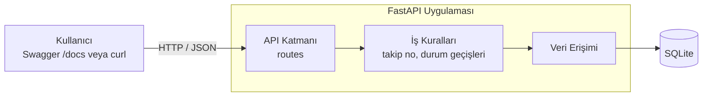
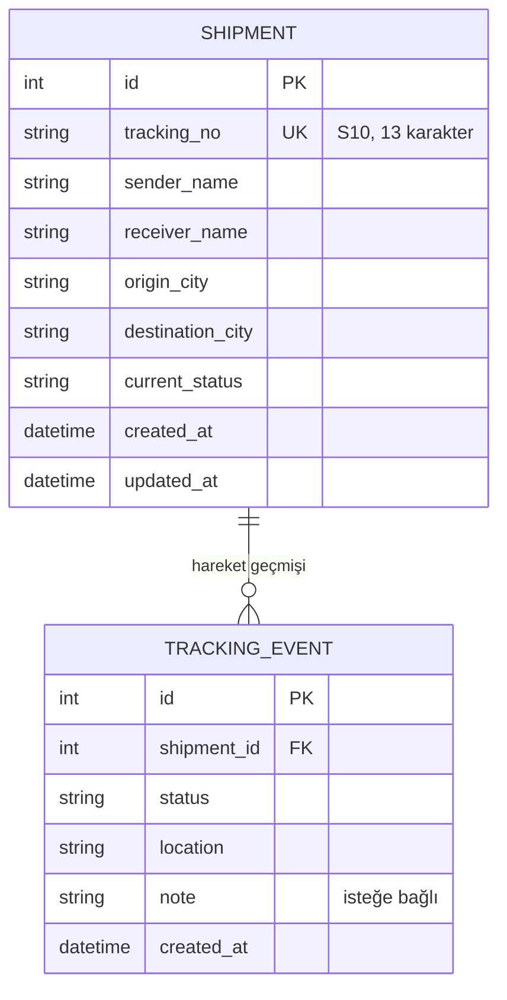
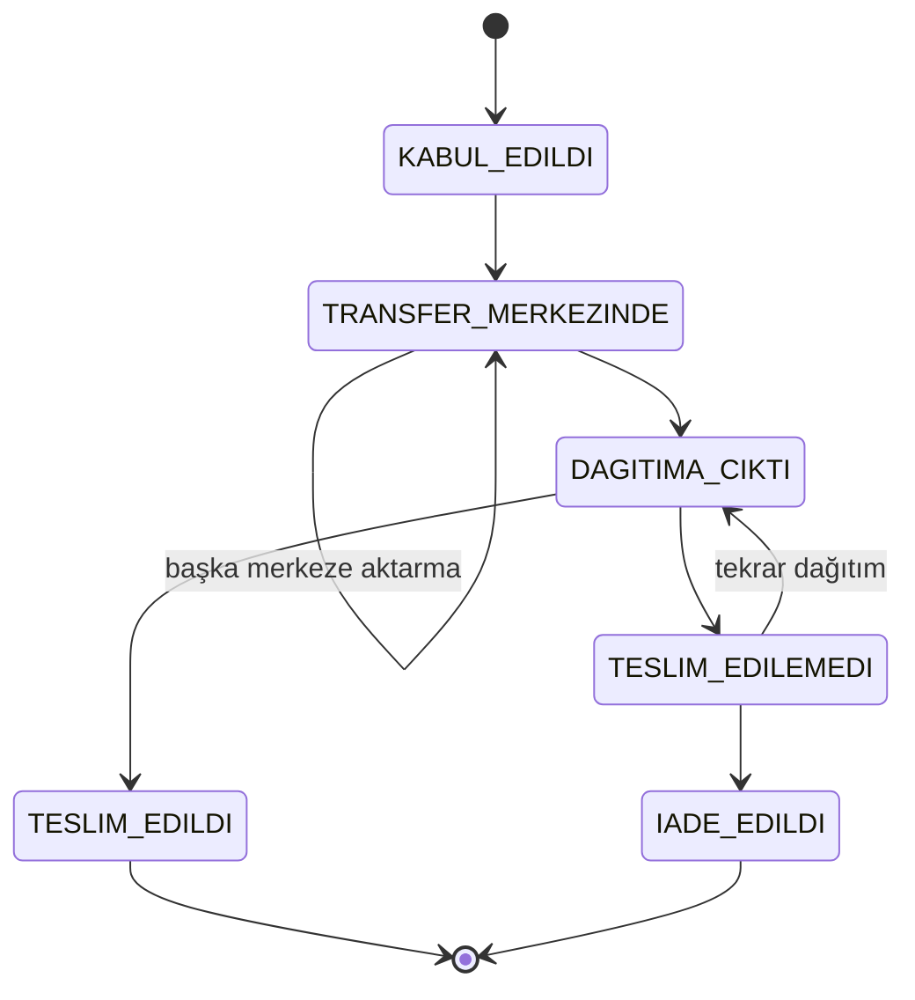
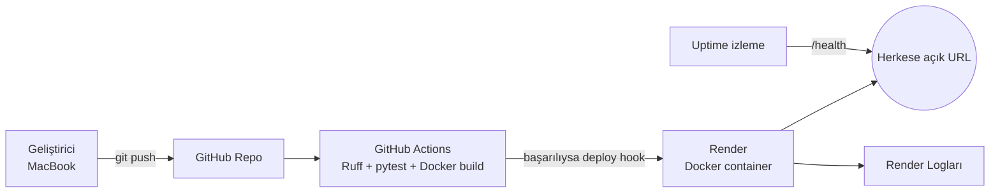

# Mimari ve Veri Modeli

Bu doküman Kargo Gönderi Takip Sistemi'nin uygulama mimarisini, veri modelini ve iş kurallarını açıklar.

## 1. Genel Bakış

Sistem, tek bir FastAPI uygulamasından ve bir SQLite veritabanından oluşan küçük bir REST API'dir. Arayüz olarak FastAPI'nin otomatik ürettiği Swagger sayfası (`/docs`) kullanılır.



## 2. Katmanlar

| Katman | Sorumluluk |
|---|---|
| **API (routes)** | HTTP isteklerini karşılar, girdileri doğrular (Pydantic), uygun HTTP durum kodunu döner |
| **İş kuralları (services)** | Takip numarası üretimi ve doğrulaması, durum geçiş kurallarının kontrolü |
| **Veri erişimi** | SQLite bağlantısı, tablo oluşturma, kayıt ekleme ve sorgulama |

İş kuralları HTTP'den bağımsız tutulur. Böylece S10 kontrol hanesi ve durum geçişleri, sunucu çalıştırılmadan doğrudan birim testleriyle test edilebilir.

## 3. Veri Modeli



- **Shipment (gönderi):** Gönderinin temel bilgileri ve güncel durumu.
- **TrackingEvent (hareket):** Her durum değişikliği yeni bir satır olarak eklenir, eski satırlar değiştirilmez. Bir gönderinin geçmişi bu tablodan zaman sırasına göre okunur.

## 4. Takip Numarası (UPU S10)

Takip numaraları, Dünya Posta Birliği'nin uluslararası gönderiler için kullandığı **S10** formatındadır:

```
K G   4 7 3 1 2 4 8 2   9   T R
└┬┘   └──────┬──────┘   │   └┬┘
hizmet    seri no      kontrol  ülke
kodu     (8 rakam)     hanesi   kodu
```

**Kontrol hanesi hesabı:**

1. Seri numarasının 8 rakamı soldan sağa sırasıyla **8, 6, 4, 2, 3, 5, 9, 7** ile çarpılıp toplanır.
2. `C = 11 − (toplam mod 11)` hesaplanır.
3. `C = 10` ise `0`, `C = 11` ise `5` kullanılır.

Örnek: `47312482` → toplam 200 → 200 mod 11 = 2 → C = 9 → **KG473124829TR**

Böylece yanlış yazılan bir takip numarası, veritabanına gidilmeden `422` hatasıyla reddedilir.

## 5. Durum Geçiş Kuralları



| Mevcut durum | İzin verilen sonraki durumlar |
|---|---|
| Kabul edildi | Transfer merkezinde |
| Transfer merkezinde | Transfer merkezinde, Dağıtıma çıktı |
| Dağıtıma çıktı | Teslim edildi, Teslim edilemedi |
| Teslim edilemedi | Dağıtıma çıktı, İade edildi |
| Teslim edildi | – (son durum) |
| İade edildi | – (son durum) |

Tabloda olmayan her geçiş `409 Conflict` ile reddedilir.

## 6. API Uç Noktaları

| Metot | Yol | Açıklama | Başarılı | Hata |
|---|---|---|---|---|
| `POST` | `/shipments` | Gönderi oluşturur | `201` | `422` eksik/hatalı alan |
| `GET` | `/shipments/{takip_no}` | Gönderi + hareket geçmişi | `200` | `422` hatalı numara, `404` bulunamadı |
| `PATCH` | `/shipments/{takip_no}/status` | Durum günceller | `200` | `404`, `409` geçersiz geçiş |
| `GET` | `/shipments?status=` | Listeler / filtreler | `200` | `422` geçersiz durum |
| `GET` | `/health` | Sağlık kontrolü | `200` | `503` veritabanı erişilemiyor |

## 7. Dağıtım Mimarisi (planlanan)



## 8. Tasarım Kararları

- **SQLite:** Ders yönergesi JSON veya SQLite'ı yeterli görüyor. Ayrı bir veritabanı sunucusu gerektirmediği için kurulum, test ve Docker süreçleri sade kalıyor.
- **Seed verisi:** Render'ın ücretsiz planında dosya sistemi kalıcı değil; deploy, yeniden başlatma ve uykuya geçişte veriler siliniyor. Bu nedenle uygulama her açılışta örnek gönderilerle kendini dolduracak. Kalıcı veri gerekirse ileride harici bir PostgreSQL'e geçilebilir.
- **İş kurallarının ayrı katmanda olması:** Takip numarası ve durum geçişleri saf Python fonksiyonları olarak yazılacak. Bu sayede birim testleri hızlı ve bağımsız çalışacak.
